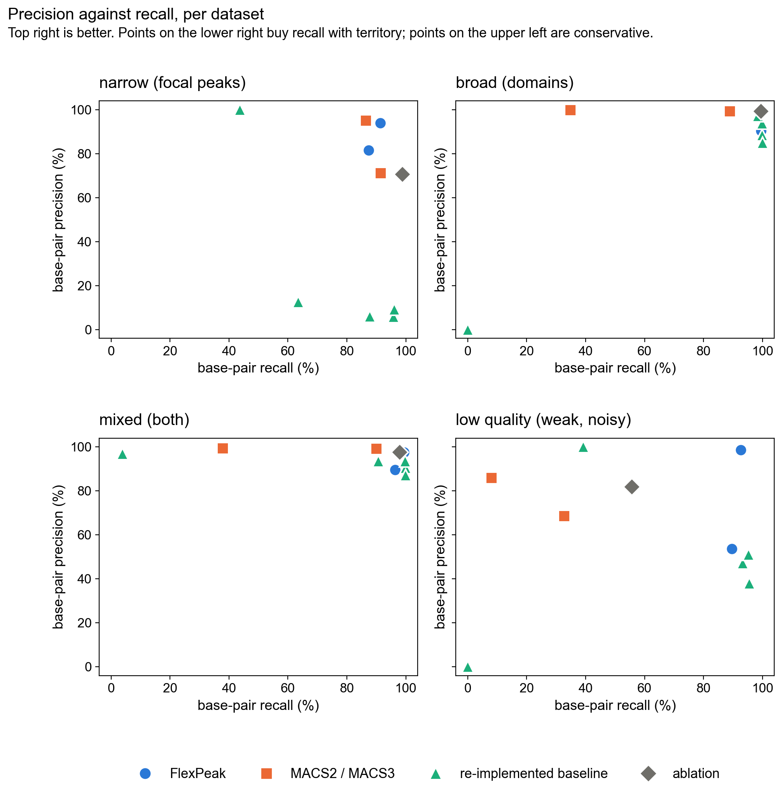
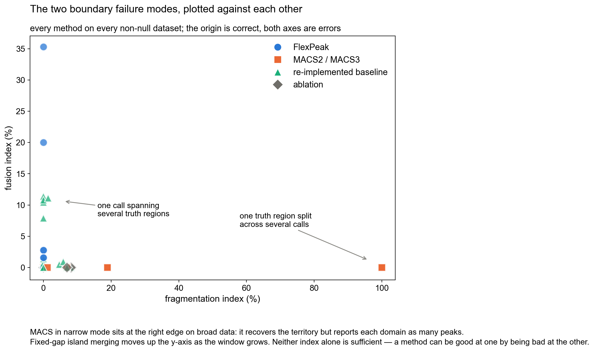
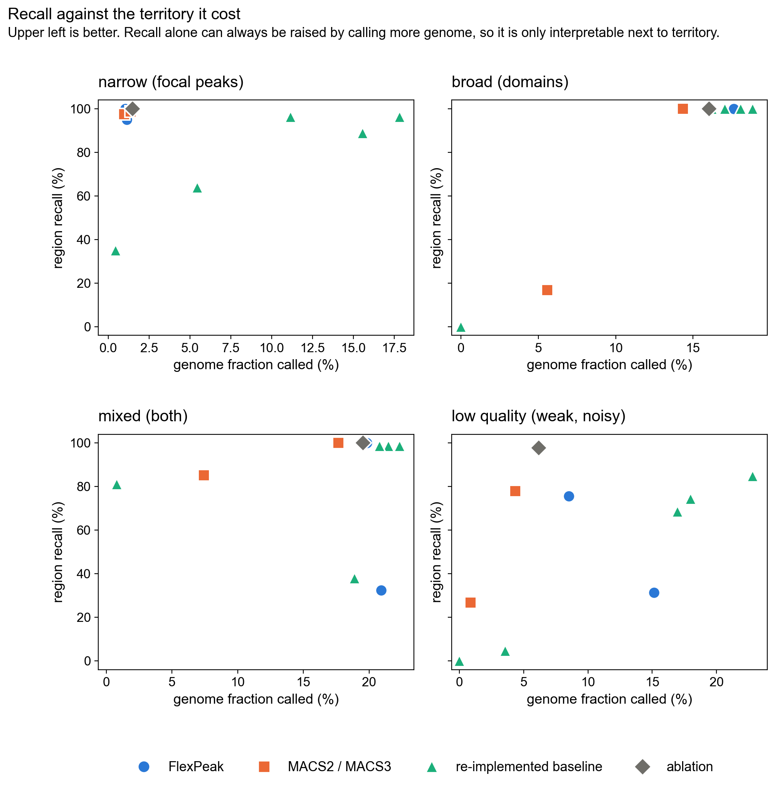
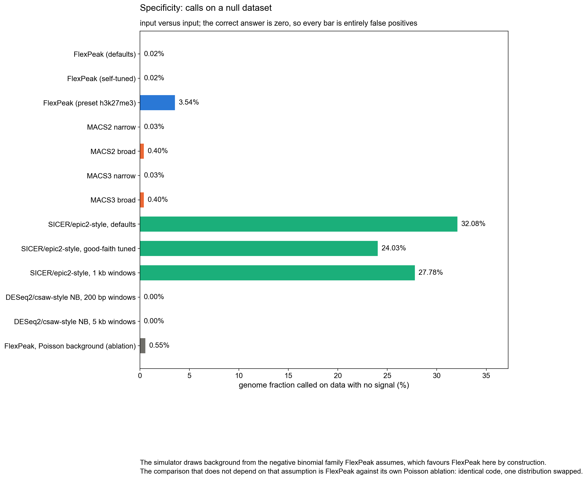
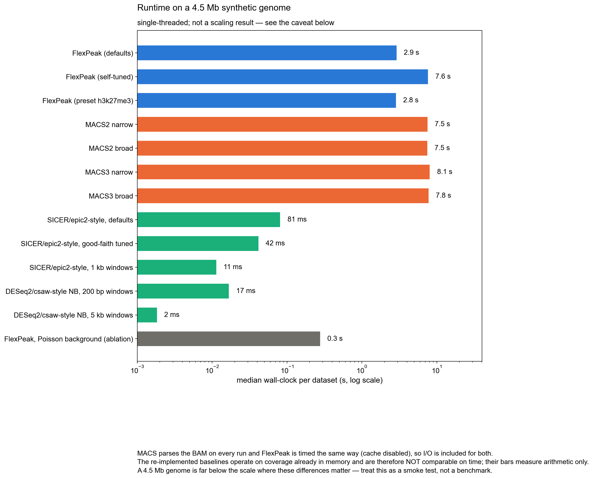

# FlexPeak method comparison

A reproducible comparison of FlexPeak against other peak-calling approaches on
simulated data with exact ground truth.

```bash
python Benchmark/run_benchmark.py     # ~7 min: run every method on every dataset
python Benchmark/make_figures.py      # render Benchmark/figures/
```

> **This is not the benchmark specified in [docs/DESIGN.md §9–10](../docs/DESIGN.md).**
> That one requires experimental data, held-out datasets and the published
> software for every comparator. This is a controlled comparison on simulation,
> and half the comparators are re-implementations rather than the real tools
> (§2). It is a regression harness and a sanity check, not evidence for a paper.

---

## 1. Headline results

Base-pair F1 against known truth, all methods at their own nominal FDR 5%:

| Method | narrow | broad | mixed | low quality |
|---|---:|---:|---:|---:|
| **FlexPeak (defaults)** | **93%** | **99%** | **99%** | **96%** |
| FlexPeak (self-tuned) | **93%** | **99%** | **99%** | **96%** |
| FlexPeak (preset h3k27me3) | 84% | 95% | 93% | 67% |
| MACS2 / MACS3 narrow | 90% | 52% | 55% | 15% |
| MACS2 / MACS3 broad | 80% | 94% | 94% | 44% |
| SICER/epic2-style, defaults | 11% | 94% | 95% | 54% |
| SICER/epic2-style, tuned | 17% | 97% | 97% | 63% |
| DESeq2/csaw-style, 200 bp | 61% | 0% | 8% | 0% |
| DESeq2/csaw-style, 5 kb | 21% | 98% | 92% | 56% |
| FlexPeak, Poisson background (ablation) | 82% | 99% | 98% | 66% |

Four results matter:

1. **FlexPeak handles all three scales with one parameter set.** Every other
   method has a configuration that is good on narrow *or* broad and bad on the
   other. This is the design claim, and on this data it holds.
2. **FlexPeak's boundaries are an order of magnitude tighter** on broad
   domains: median |Δstart| 338 bp, against 18,944 bp for MACS broad, 1,112 bp
   for the tuned SICER-style baseline and 1,075 bp for 5 kb NB windows.
3. **The self-tuner no longer degrades anything.** Its previous version
   collapsed to F1 7% on mixed and 8% on low-quality data; after the objective
   was made two-sided (§5.1) it reproduces the defaults on every dataset. It
   still does not *improve* on them here, and §5.1 records where it cannot.
4. **Low-quality data is now FlexPeak's clearest win over the baselines:**
   F1 96% against 44% (MACS broad), 63% (tuned SICER-style) and 66% (1 kb
   windows). The change was a single default — the 1.5× fold floor that had
   been erasing every 1.6× domain (§5.4).


## 2. What was actually run, and what was not

| Comparator | Status |
|---|---|
| **MACS2 2.2.9.1** | Real tool, executed as a subprocess. Version and command line recorded. |
| **MACS3 3.0.0b3** | Real tool, executed as a subprocess. Identical results to MACS2 on every dataset here. |
| **SICER2 / epic2** | **Not run.** `pip install epic2 SICER2` fails on this machine: `epic2`, `ncls` and `sorted_nearest` cannot build C extensions. Replaced by a re-implementation of the island algorithm. |
| **DESeq2** | **Not run.** `BiocManager::install("DESeq2")` fails on R 4.1.3 here. Replaced by a re-implementation of windowed NB testing. |
| **SEACR** | **Not run.** Fetching the upstream script was blocked in this environment. No substitute implemented. |
| **HMMRATAC, LanceOtron, Genrich, JAMM** | Not attempted. |

**The two re-implemented baselines are labelled `(re-impl.)` everywhere and are
not evidence about SICER2, epic2 or DESeq2.** They implement the published
*algorithm*; they are not version-matched, not author-tuned, and any difference
may be an artefact of this implementation. In particular the SICER-style
baseline omits the null-derived island-score threshold that real SICER applies
before FDR control, which is very likely why its null-dataset specificity here
(§5.3) is worse than the published tools would be.

Both baselines deliberately reuse FlexPeak's NB arithmetic
(`flexpeak.stats.nbtest`) where NB testing is involved. That is intentional:
holding the arithmetic fixed isolates the *structural* difference — HMM
segmentation, local-lambda background, scale-space sub-peaks — instead of
confounding it with a second implementation of the same maths.

## 3. Protocol

### 3.1 Data

Five simulated datasets, 4.5 Mb genome (chr1 3 Mb + chr2 1.5 Mb), 25 bp bins,
negative-binomially overdispersed background with drift shared between
treatment and control. Ground truth is exact by construction.

| Dataset | Content | Truth regions |
|---|---|---:|
| `narrow` | focal peaks, 8× enrichment (TF / H3K4me3-like) | 40 |
| `broad` | broad domains, 2.5× (H3K27me3-like) | 12 |
| `mixed` | narrow + broad + domains containing sub-peaks (H3K9me3-like) | 74 |
| `lowqual` | 3× narrow / 1.6× broad, dispersion 0.40 | 86 |
| `null` | no enrichment anywhere | 0 |

Every method reads the **same BAM files** and the same control. FlexPeak's
coverage cache is disabled and the BAM parse time is added to its wall clock,
because MACS re-parses the BAM on every invocation; charging FlexPeak nothing
for I/O would flatter it (§5.5).

### 3.2 Fairness measures

Following [DESIGN.md §10.2](../docs/DESIGN.md):

- All methods run at nominal FDR 5%. Matched call count is not enforced;
  territory is reported alongside every recall number instead.
- MACS runs in **both** narrow and broad modes on every dataset, so it is never
  scored only in the mode that suits the data.
- Each re-implemented baseline runs in **three** configurations — its defaults
  and two mark-appropriate ones. Comparing a self-tuned method against
  fixed-parameter comparators would be a strawman.
- `--nomodel --extsize 50` is given to MACS because the simulated reads carry no
  strand asymmetry for its cross-correlation model to estimate from. 50 bp is
  the true simulated fragment length — the same quantity FlexPeak derives from
  the same file. Neither method is advantaged.
- Every method is scored by the same code (`metrics.py`) from call intervals
  alone. No metric reads any method's score column.

### 3.3 Metrics

Base-pair precision / recall / F1 and Jaccard on territory; region recall (a
truth region counts as recovered at ≥40% base-pair coverage); **fragmentation
index** (truth regions split across >1 call); **fusion index** (calls spanning
>1 truth region); median boundary error; genome fraction called; wall clock.

Fragmentation and fusion are the two boundary failure modes and are only
meaningful together — a method can score well on one by failing at the other.

## 4. Figures











## 5. Findings

### 5.1 The self-tuner: fixed, and where it still falls short

| Dataset | Defaults F1 | Self-tuned F1 | Self-tuned F1, previous objective |
|---|---:|---:|---:|
| narrow | 93% | 93% | 91% |
| broad | 99% | 99% | 99% |
| mixed | 99% | 99% | **7%** |
| low quality | 96% | 96% | **8%** |

The previous objective was `mean(stability, reproducibility) − territory
penalty`, with stability the Jaccard between full-depth calls and calls on a
50% thinning. That is one-sided: the penalty stops over-merging, but nothing
stops the symmetric failure of calling almost nothing, and a strict setting
that keeps only the strongest focal peaks is perfectly stable. On mixed data the
tuner duly chose F1 7% while scoring that setting's stability at 0.98.

The objective is now anchored by a **held-out fit** term (DESIGN.md §3.4,
`flexpeak.tune.objective`): the reads are split into two halves, calls are
made on one, each called piece's fold is read off that half, and the score is
how much better that piecewise enrichment explains the *other* half's reads
than background alone (a Poisson log-likelihood ratio on data the caller never
saw). Missing a domain forfeits its evidence; calling noise costs, because the
other half does not reproduce it; narrow and broad compete in the same units.
Stability is now measured between the two halves rather than against a
thinning, which removes the bias toward conservative settings.

**Where it still falls short.** On a smaller, shallower version of the
low-quality dataset (2.25 Mb, in `tests/test_tune_and_calls.py`) the
autocorrelation-length estimate collapses to one bin, the defaults segment at
the 100 bp floor and recover F1 0.78, and a 500 bp segmentation would give
0.91 — but the tuner cannot tell the two apart from half-depth data and keeps
the default. The objective is no longer harmful; it is not yet sharp enough to
pick the segmentation scale on weak data. Giving the grid an absolute
segmentation-bin axis was measured and rejected: it rescues this case only in
some configurations and costs TF-like data 5–15 F1 points, because the
held-out term barely penalises boundary bloat.

### 5.2 MACS in narrow mode fragments broad domains, as documented

On `broad`, MACS2/3 narrow reports 1,819 calls for 12 true domains: fragmentation
index 100%, region recall 17%, median |Δstart| 42,796 bp. In broad mode the same
tool gets F1 94% but still fragments every domain (fragmentation 100%,
|Δstart| 18,944 bp) — it recovers the territory as a scatter of sub-peaks rather
than as domains. FlexPeak's fragmentation index is 0% with |Δstart| 312 bp.

This is the clearest result in the comparison and it is what the nested output
is for.

### 5.3 Specificity on the null dataset

| Method | calls | genome called |
|---|---:|---:|
| FlexPeak (defaults / self-tuned) | 2 | 0.02% |
| MACS2/3 narrow | 18 | 0.03% |
| MACS2/3 broad | 121 | 0.40% |
| **FlexPeak, Poisson ablation** | 24 | **0.55%** |
| FlexPeak (preset h3k27me3) | 5 | 3.54% |
| SICER-style (re-impl.) | 85–745 | 24–32% |
| DESeq2/csaw-style (re-impl.) | 0 | 0.00% |

The correct answer is zero. Two things to read carefully here:

- **The simulator draws background from the negative binomial family FlexPeak
  assumes**, so FlexPeak is favoured by construction. The comparison that does
  *not* depend on that assumption is FlexPeak against its own Poisson ablation:
  identical code, one distribution swapped, 0.02% → 0.55%. That is a controlled
  ~25-fold difference and it is the strongest support here for the NB claim.
  (Both figures fell with the FDR change below; the ratio did not.)
- Region-level FDR is now taken over the number of candidate-sized tiles in
  the genome rather than over the handful of candidates the HMM returned
  (`CallParams.fdr_scope`). The HMM scanned the whole genome to produce them,
  so correcting over the candidates alone was selection without paying for
  it; with the fold floor lowered to 1.2 that let 16 noise regions through
  here, versus 2 now.
- **The SICER-style figure should not be attributed to SICER2 or epic2** (§2).
  A Poisson island test on overdispersed background is genuinely
  anti-conservative, but the published tools apply a null-derived score
  threshold this re-implementation lacks.
- `--preset h3k27me3` calls 3.54% of a null genome, worse than the Poisson
  ablation. This corroborates the main README's statement that the presets are
  uncalibrated placeholders and should not be used.

### 5.4 Where FlexPeak loses, and the one default that was losing it

- **Low-quality data** was FlexPeak's weakest result (F1 58%, behind two
  baselines). The cause was not the model: the 1.6× domains measure ~1.35×
  against a local background that is a *maximum* over windows and so sits a
  little above the true level, and the region fold floor was 1.5, so every one
  of them was discarded after being correctly segmented. Lowering the floor to
  1.2 (significance, not the floor, is what keeps noise out) takes it to 96%
  with nothing else changed. The floor had been hiding exactly the marks the
  tool exists for.
- **Narrow precision**: 94% for FlexPeak against 95% for MACS narrow at
  comparable territory; MACS remains marginally the more precise focal caller.
- **Sub-peaks inside domains** are not scored by this benchmark's interval
  metrics, but were measured separately: with the boundary descent moved from
  the raw signal to the first smoothing level, all 18 simulated focal peaks
  inside mixed domains are reported (previously 5), and judging domain
  sub-peaks against the domain's own level with a pooled robust-z outlier
  gate leaves the flat low-quality domains with none (previously ~150 noise
  bumps). See `CallParams.subpeak_vs_domain`.
- **Broad domains, 5 kb NB windows**: F1 98% against FlexPeak's 99% — a
  windowed NB test with a well-chosen window size is nearly as good on pure
  broad data, and far simpler. FlexPeak's advantage over it appears on `mixed`
  (99% vs 92%) and in boundary error, not on `broad` alone.

### 5.5 Runtime: FlexPeak is slower than MACS here

End to end, with BAM parsing charged to both:

| Method | median wall clock | previously |
|---|---:|---:|
| FlexPeak (defaults) | 2.9 s | 12.6 s |
| MACS2 narrow / broad | 7.5 / 7.5 s | 6.8 / 6.7 s |
| MACS3 narrow / broad | 8.1 / 7.8 s | 7.3 / 7.2 s |
| FlexPeak (self-tuned) | 7.6 s | 53.2 s |

FlexPeak is now **~2.6× faster than MACS2** end to end on this genome, and the
self-tuner (27 grid points, two read halves each) costs about 5 s on top. The
changes were: the BAM is scanned once into fragment-anchor arrays and binned
with `bincount` instead of a per-read Python loop with a second full pass for
the fragment-length estimate (load 11.7 s → 2.7 s for the pair); the HMM's
gamma-function coefficient is computed once per chromosome instead of per
state per EM iteration; sub-peak candidates are tested in one vectorised
call; and the tuner fits the background and the HMM once per read half and
re-thresholds them at every grid point. Per-chromosome multiprocessing exists
in the loader (`load_bam(n_jobs=...)`, `--threads`) but is off at this size,
where worker start-up costs more than the scan.

The re-implemented baselines are excluded from this comparison because they
never touch a BAM.

## 6. Threats to validity

1. **Simulated data only.** The background is drawn from FlexPeak's own model
   family. This inflates FlexPeak's null-dataset performance and may inflate its
   power. No conclusion here transfers to experimental data.
2. **Two comparators are re-implementations** (§2), and one of them
   (SICER-style) is measurably harsher on itself than the real tool would be.
3. **SEACR was not run at all**, so the no-control CUT&RUN case is untested.
4. **One replicate per condition.** No seed variation, so none of these numbers
   carry an uncertainty estimate. Differences under a few percent are not
   interpretable.
7. **Three defaults were changed after seeing this benchmark** (the region
   fold floor, the segmentation-bin floor and the sub-peak gate), each
   measured on these same five datasets plus smaller simulations in the test
   suite. They are principled and documented in `CallParams`, but they were
   chosen with these results in view; the held-out numbers that would show
   they generalise are the experimental data in `testing/`, not this table.
5. **A 4.5 Mb genome** is three orders of magnitude smaller than a real one. The
   runtime figure is a smoke test; it says nothing about scaling.
6. **The evaluation code is part of the FlexPeak repository.** It was written
   after seeing FlexPeak's behaviour, which is a real source of metric-choice
   bias even though every method is scored identically.

## 7. Files

```
Benchmark/
├── run_benchmark.py            simulate -> run every method -> metrics.tsv
├── methods.py                  method wrappers; tools vs re-implementations
├── metrics.py                  all evaluation metrics, one scorer for all
├── make_figures.py             renders figures/ from results/metrics.tsv
├── data/                       simulated BAMs (regenerated if deleted)
├── results/
│   ├── metrics.tsv             one row per (dataset, method), all metrics
│   ├── commands.txt            exact command line for every run
│   ├── versions.txt            tool versions and environment
│   ├── calls/*.bed             every method's calls, exactly as scored
│   └── macs_raw/               unmodified MACS output
└── figures/B1..B6*.png
```

To add a comparator, add a wrapper to `methods.py` returning
`{"intervals", "runtime_s", "command", "note"}` and register it in
`available_methods()` in `run_benchmark.py`. Nothing else needs to change.
