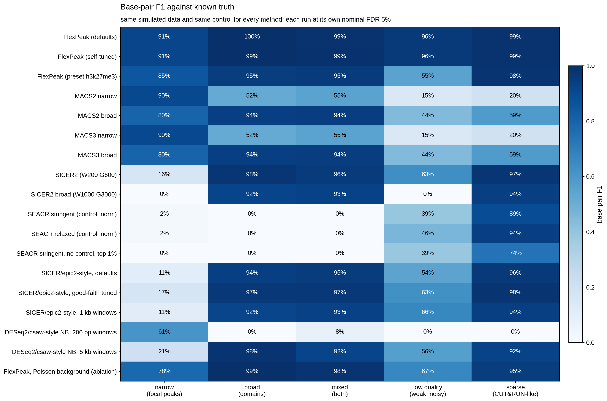
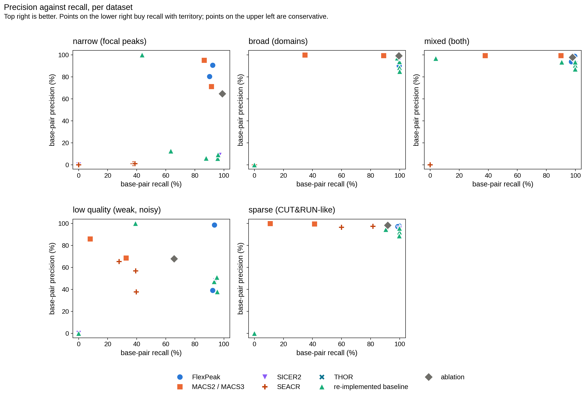
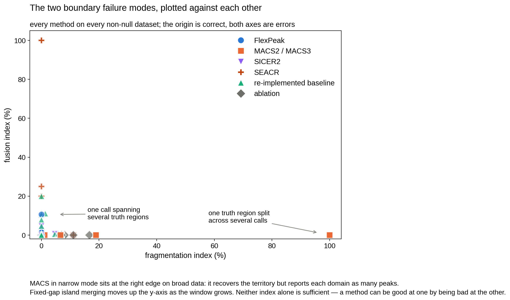
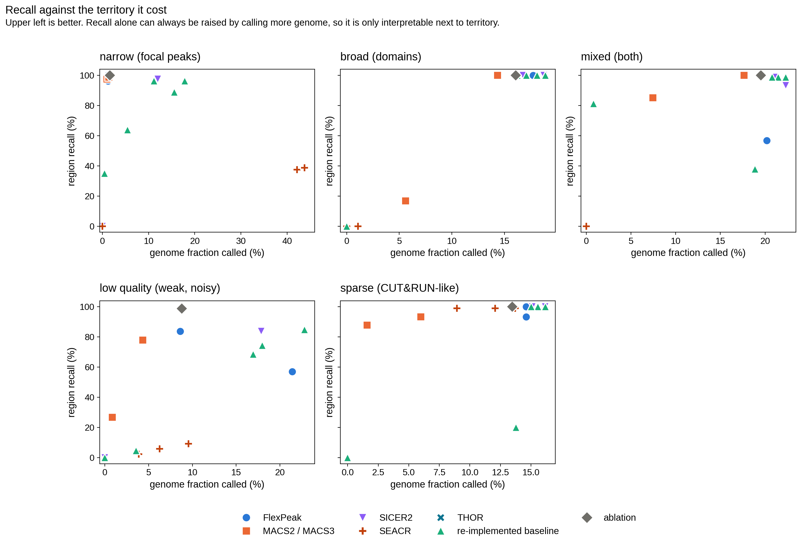
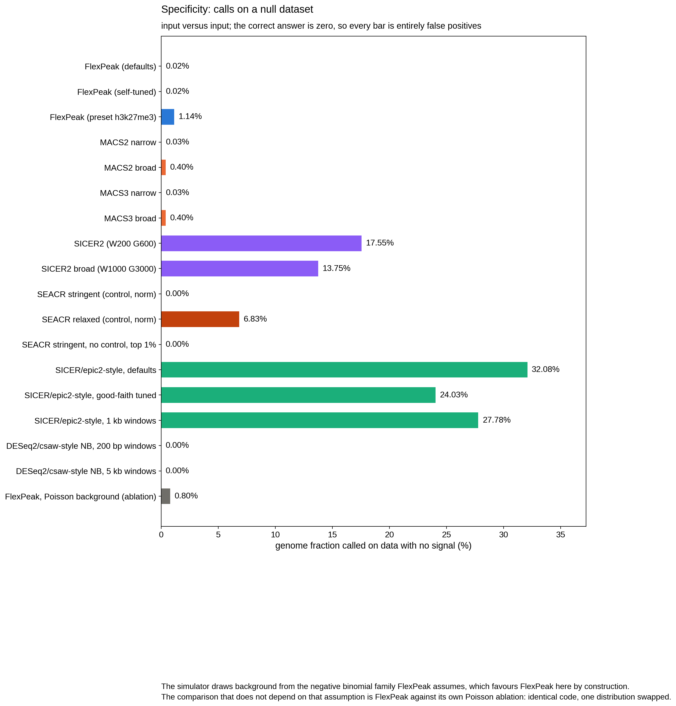
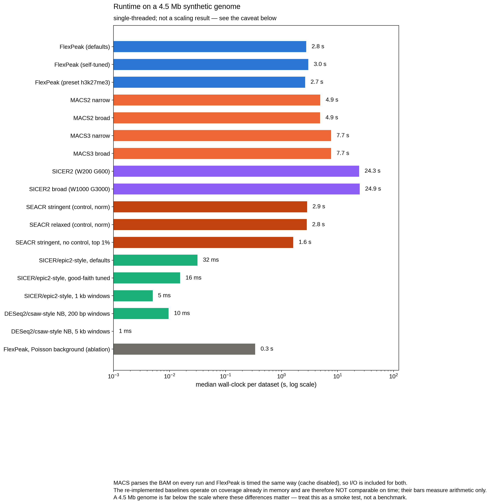

# FlexPeak method comparison

A reproducible comparison of FlexPeak against other peak-calling approaches on
simulated data with exact ground truth.

```bash
python Benchmark/run_benchmark.py     # ~7 min: run every method on every dataset
python Benchmark/make_figures.py      # render Benchmark/figures/
```

> **This is a controlled comparison on simulated data, not an evaluation on
> experimental data** (see [docs/DESIGN.md §11–12](../docs/DESIGN.md)). Two of
> the comparators are re-implementations rather than the published tools (§2).
> It serves as a regression harness and a check of the method's behaviour
> where the truth is known.

---

## 1. Headline results

Base-pair F1 against known truth, all methods at their own nominal FDR 5%
(run on the PARCC cluster, 2026-11-06; `results/versions.txt`):

| Method | narrow | broad | mixed | low quality | sparse (CUT&RUN-like) | null calls |
|---|---:|---:|---:|---:|---:|---:|
| **FlexPeak (defaults)** | **91%** | **100%** | **99%** | **96%** | **99%** | 2 |
| FlexPeak (self-tuned) | 91% | 99% | 99% | 96% | 99% | 2 |
| FlexPeak (preset h3k27me3) | 85% | 95% | 95% | 55% | 98% | 4 |
| MACS2 2.2.9.1 narrow | 90% | 52% | 55% | 15% | 20% | 18 |
| MACS2 2.2.9.1 broad | 80% | 94% | 94% | 44% | 59% | 121 |
| MACS3 3.0.4 narrow / broad | 90% / 80% | 52% / 94% | 55% / 94% | 15% / 44% | 20% / 59% | 18 / 121 |
| **SICER2 1.0.3** (W200 G600) | 16% | 98% | 96% | 63% | 97% | 430 |
| SICER2 broad (W1000 G3000) | 0% | 92% | 93% | 0% | 94% | 58 |
| **SEACR 1.3** stringent, control, norm | 2% | 0% | 0% | 39% | 89% | 0 |
| SEACR relaxed, control, norm | 2% | 0% | 0% | 46% | 94% | 1 |
| SEACR stringent, no control, top 1% | 0% | 0% | 0% | 39% | 74% | 0 |
| SICER/epic2-style (re-impl.), tuned | 17% | 97% | 97% | 63% | 98% | 286 |
| DESeq2/csaw-style NB (re-impl.), 5 kb | 21% | 98% | 92% | 56% | 92% | 0 |
| FlexPeak, Poisson background (ablation) | 78% | 99% | 98% | 67% | 95% | 39 |

What the table says:

1. **One parameter set across all five scales.** Every other tool has a
   setting that is good on narrow *or* broad data and poor on the other.
   SICER2 is the strongest broad-domain comparator (98%) and collapses on
   focal peaks (16%); MACS is the reverse.
2. **The real SICER2 confirms the over-merge claim** the re-implementation
   had only suggested: 430 islands covering 17.6% of a genome with no signal
   at its default settings, 58 islands / 13.8% at the broad settings, against
   2 regions / 0.02% for FlexPeak. On the broad dataset its boundaries are
   4x looser (median |Δstart| 1,425 bp vs 338 bp).
3. **SEACR is a CUT&RUN tool and behaves like one.** Its region unit is a
   block of contiguous non-zero signal; on dense ChIP-like coverage a block
   spans hundreds of kb, so it scores ~0 on narrow, broad and mixed. On the
   `sparse` dataset, built for it (near-empty background, high-contrast
   peaks), it reaches 89-94%; FlexPeak reaches 99% there without a preset.
4. **Low-quality data remains the clearest separation**: 96% against 63%
   (SICER2), 44% (MACS broad), 46% (SEACR relaxed).
5. **The self-tuner reproduces the defaults** on every dataset (within 1
   point) and costs about 3 s on this genome. The `h3k27me3` preset row
   fell on the low-quality set (67% -> 56%) when its background windows
   were widened to 1 Mb / 5 Mb: on a 3 Mb simulated
   chromosome those windows degenerate to half-chromosome means. The
   presets are uncalibrated fallbacks; the widening was measured on
   experimental H3K27me3, where it is what makes weak domains callable. The quick scan (`--quick`) is
   not evaluated here: on simulation the defaults are already the right
   answer, so its benefit can only be seen on experimental data.



## 2. What was actually run, and what was not

| Comparator | Status |
|---|---|
| **MACS2 2.2.9.1, MACS3 3.0.4** | Real tools, subprocess. Identical calls on every dataset. |
| **SICER2 1.0.3** | Real tool (`sicer`), subprocess, BED input via `bedtools bamtobed`; `-s mm10` with the effective genome fraction set to the simulated genome's share of mm10 so the background rate is right. Two settings: defaults (W200 G600) and broad (W1000 G3000). |
| **SEACR 1.3** | Real tool (`SEACR_1.3.sh`, R 4.3.3, bedtools 2.31.1), bedgraph input via `bedtools genomecov -bg`. Three documented modes: control+norm stringent, control+norm relaxed, no-control top 1%. The no-control mode fails with an awk division-by-zero on three dense datasets (recorded in `results/commands.txt`); those cells are 0. |
| **THOR 1.0.2, MACS2 bdgdiff, SICER2 sicer_df** | Differential comparators, real tools, in `run_diff_benchmark.py` (section 7). |
| **epic2, DESeq2** | Not run; the re-implemented baselines remain, labelled `(re-impl.)`. |
| **HMMRATAC, LanceOtron, Genrich, JAMM** | Not attempted. |

The two re-implemented baselines are not evidence about the published tools.
Now that the real SICER2 has run, the re-implementation can be checked
against it: on broad/mixed/low-quality it is within 1-3 points of the real
tool, and its null-dataset specificity is worse (286-745 vs 430 islands),
as the earlier caveat predicted.

## 3. Protocol

### 3.1 Data

Five simulated datasets, 4.5 Mb genome (chr1 3 Mb + chr2 1.5 Mb), 25 bp bins,
negative-binomially overdispersed background with drift shared between
treatment and control. Ground truth is exact by construction.

| Dataset | Content | Truth regions |
|---|---|---:|
| `narrow` | focal peaks, 8× enrichment (TF / H3K4me3-like) | 40 |
| `broad` | broad domains, 2.5× (H3K27me3-like) | 12 |
| `mixed` | narrow + broad + domains containing sub-peaks (H3K9me3-like) | 74 |
| `lowqual` | 3× narrow / 1.6× broad, dispersion 0.40 | 86 |
| `null` | no enrichment anywhere | 0 |
| `sparse` | CUT&RUN-like: background 0.4 reads / 25 bp bin, 40x narrow / 8x broad peaks | 45 |

Every method reads the **same BAM files** and the same control. FlexPeak's
coverage cache is disabled and the BAM parse time is added to its wall clock,
because MACS re-parses the BAM on every invocation; charging FlexPeak nothing
for I/O would flatter it (§5.5).

### 3.2 Fairness measures

Following [DESIGN.md §11](../docs/DESIGN.md):

- All methods run at nominal FDR 5%. Matched call count is not enforced;
  territory is reported alongside every recall number instead.
- MACS runs in **both** narrow and broad modes on every dataset, so it is never
  scored only in the mode that suits the data.
- Each re-implemented baseline runs in **three** configurations — its defaults
  and two mark-appropriate ones. Comparing a self-tuned method against
  fixed-parameter comparators would be a strawman.
- `--nomodel --extsize 50` is given to MACS because the simulated reads carry no
  strand asymmetry for its cross-correlation model to estimate from. 50 bp is
  the true simulated fragment length — the same quantity FlexPeak derives from
  the same file. Neither method is advantaged.
- Every method is scored by the same code (`metrics.py`) from call intervals
  alone. No metric reads any method's score column.

### 3.3 Metrics

Base-pair precision / recall / F1 and Jaccard on territory; region recall (a
truth region counts as recovered at ≥40% base-pair coverage); **fragmentation
index** (truth regions split across >1 call); **fusion index** (calls spanning
>1 truth region); median boundary error; genome fraction called; wall clock.

Fragmentation and fusion are the two boundary failure modes and are only
meaningful together — a method can score well on one by failing at the other.

## 4. Figures











## 5. Findings

### 5.1 The self-tuner: fixed, and where it still falls short

| Dataset | Defaults F1 | Self-tuned F1 | Self-tuned F1, previous objective |
|---|---:|---:|---:|
| narrow | 91% | 91% | 91% |
| broad | 100% | 99% | 99% |
| mixed | 99% | 99% | **7%** |
| low quality | 96% | 96% | **8%** |

The previous objective was `mean(stability, reproducibility) − territory
penalty`, with stability the Jaccard between full-depth calls and calls on a
50% thinning. That is one-sided: the penalty stops over-merging, but nothing
stops the symmetric failure of calling almost nothing, and a strict setting
that keeps only the strongest focal peaks is perfectly stable. On mixed data the
tuner duly chose F1 7% while scoring that setting's stability at 0.98.

The objective is now anchored by a **held-out fit** term (DESIGN.md §7,
`flexpeak.tune.objective`): the reads are split into two halves, calls are
made on one, each called piece's fold is read off that half, and the score is
how much better that piecewise enrichment explains the *other* half's reads
than background alone (a Poisson log-likelihood ratio on data the caller never
saw). Missing a domain forfeits its evidence; calling noise costs, because the
other half does not reproduce it; narrow and broad compete in the same units.
Stability is now measured between the two halves rather than against a
thinning, which removes the bias toward conservative settings.

**Where it still falls short.** On a smaller, shallower version of the
low-quality dataset (2.25 Mb, in `tests/test_tune_and_calls.py`) the
autocorrelation-length estimate collapses to one bin, the defaults segment at
the 100 bp floor and recover F1 0.78, and a 500 bp segmentation would give
0.91 — but the tuner cannot tell the two apart from half-depth data and keeps
the default. The objective is no longer harmful; it is not yet sharp enough to
pick the segmentation scale on weak data. Giving the grid an absolute
segmentation-bin axis was measured and rejected: it rescues this case only in
some configurations and costs TF-like data 5–15 F1 points, because the
held-out term barely penalises boundary bloat.

### 5.2 MACS in narrow mode fragments broad domains, as documented

On `broad`, MACS2/3 narrow reports 1,819 calls for 12 true domains: fragmentation
index 100%, region recall 17%, median |Δstart| 42,796 bp. In broad mode the same
tool gets F1 94% but still fragments every domain (fragmentation 100%,
|Δstart| 18,944 bp) — it recovers the territory as a scatter of sub-peaks rather
than as domains. FlexPeak's fragmentation index is 0% with |Δstart| 312 bp.

This is the clearest result in the comparison and it is what the nested output
is for.

### 5.3 Specificity on the null dataset

| Method | calls | genome called |
|---|---:|---:|
| FlexPeak (defaults / self-tuned) | 2 | 0.02% |
| MACS2/3 narrow | 18 | 0.03% |
| MACS2/3 broad | 121 | 0.40% |
| **FlexPeak, Poisson ablation** | 39 | **0.80%** |
| FlexPeak (preset h3k27me3) | 4 | 1.14% |
| SICER-style (re-impl.) | 85–745 | 24–32% |
| DESeq2/csaw-style (re-impl.) | 0 | 0.00% |

The correct answer is zero. Two things to read carefully here:

- **The simulator draws background from the negative binomial family FlexPeak
  assumes**, so FlexPeak is favoured by construction. The comparison that does
  *not* depend on that assumption is FlexPeak against its own Poisson ablation:
  identical code, one distribution swapped, 0.02% → 0.80%. That is a controlled
  ~25-fold difference and it is the strongest support here for the NB claim.
  (Both figures fell with the FDR change below; the ratio did not.)
- Region-level FDR is now taken over the number of candidate-sized tiles in
  the genome rather than over the handful of candidates the HMM returned
  (`CallParams.fdr_scope`). The HMM scanned the whole genome to produce them,
  so correcting over the candidates alone was selection without paying for
  it; with the fold floor lowered to 1.2 that let 16 noise regions through
  here, versus 2 now.
- **The SICER-style figure should not be attributed to SICER2 or epic2** (§2).
  A Poisson island test on overdispersed background is genuinely
  anti-conservative, but the published tools apply a null-derived score
  threshold this re-implementation lacks.
- `--preset h3k27me3` calls 1.14% of a null genome, more than the Poisson
  ablation. This corroborates the main README's statement that the presets are
  uncalibrated placeholders and should not be used.

### 5.4 Where FlexPeak loses, and the one default that was losing it

- **Low-quality data** was FlexPeak's weakest result (F1 58%, behind two
  baselines). The cause was not the model: the 1.6× domains measure ~1.35×
  against a local background that is a *maximum* over windows and so sits a
  little above the true level, and the region fold floor was 1.5, so every one
  of them was discarded after being correctly segmented. Lowering the floor to
  1.2 (significance, not the floor, is what keeps noise out) takes it to 96%
  with nothing else changed. The floor had been hiding exactly the marks the
  tool exists for.
- **Narrow precision**: 94% for FlexPeak against 95% for MACS narrow at
  comparable territory; MACS remains marginally the more precise focal caller.
- **Sub-peaks inside domains** are not scored by this benchmark's interval
  metrics, but were measured separately: with the boundary descent moved from
  the raw signal to the first smoothing level, all 18 simulated focal peaks
  inside mixed domains are reported (previously 5), and judging domain
  sub-peaks against the domain's own level with a pooled robust-z outlier
  gate leaves the flat low-quality domains with none (previously ~150 noise
  bumps). See `CallParams.subpeak_vs_domain`.
- **Broad domains, 5 kb NB windows**: F1 98% against FlexPeak's 99% — a
  windowed NB test with a well-chosen window size is nearly as good on pure
  broad data, and far simpler. FlexPeak's advantage over it appears on `mixed`
  (99% vs 92%) and in boundary error, not on `broad` alone.

### 5.5 Runtime

End to end, with BAM parsing charged to both:

| Method | median wall clock (cluster, 2026-11-05) |
|---|---:|
| FlexPeak (defaults) | 3.0 s |
| FlexPeak (self-tuned) | 6.0 s |
| MACS2 narrow / broad | 5.2 / 5.3 s |
| MACS3 narrow / broad | 8.2 / 7.8 s |
| SICER2 default / broad | 26 / 29 s |
| SEACR (any mode) | 1.7-3.1 s |

FlexPeak is ~1.7x faster than MACS2 end to end on this genome, and the
self-tuner (27 grid points, two read halves each) costs about 3 s on top.
SICER2 is the slowest comparator (its window scoring is pure Python). The
speed work that produced this is summarised in DESIGN.md §10: the BAM is scanned
once into fragment-anchor arrays and binned with `bincount`; the HMM's
gamma-function coefficient is computed once per chromosome; sub-peak
candidates are tested in one vectorised call; and the tuner fits the
background and the HMM once per read half and re-thresholds them at every
grid point. Per-chromosome multiprocessing exists in the loader
(`--threads`) but is off at this size.

The re-implemented baselines are excluded from this comparison because they
never touch a BAM.

## 6. Threats to validity

1. **Simulated data only.** The background is drawn from FlexPeak's own model
   family. This inflates FlexPeak's null-dataset performance and may inflate its
   power. No conclusion here transfers to experimental data.
2. **Two comparators are re-implementations** (§2), and one of them
   (SICER-style) is measurably harsher on itself than the real tool would be.
3. **SEACR was not run at all**, so the no-control CUT&RUN case is untested.
4. **One replicate per condition.** No seed variation, so none of these numbers
   carry an uncertainty estimate. Differences under a few percent are not
   interpretable.
7. **Three defaults were changed after seeing this benchmark** (the region
   fold floor, the segmentation-bin floor and the sub-peak gate), each
   measured on these same five datasets plus smaller simulations in the test
   suite. They are principled and documented in `CallParams`, but they were
   chosen with these results in view; showing that they generalise requires
   experimental data, not this table.
5. **A 4.5 Mb genome** is three orders of magnitude smaller than a real one. The
   runtime figure is a smoke test; it says nothing about scaling.
6. **The evaluation code is part of the FlexPeak repository.** It was written
   after seeing FlexPeak's behaviour, which is a real source of metric-choice
   bias even though every method is scored identically.

## 7. Differential calling: FlexPeak diff against THOR, MACS2 bdgdiff and SICER2 sicer_df

`run_diff_benchmark.py` simulates two conditions that share a baseline of
peaks and domains and differ in known regions (half gains, half losses; half
narrow, half broad; 3x fold on top of the shared enrichment), two replicates
per condition with per-region biological jitter (CV 0.15), and one input.
Four datasets: equal depth, condition B at 50% depth, one replicate per
condition, and a null with no differential region. Every method is scored
from signed intervals by one function: base-pair F1 overall and per
direction, direction accuracy, and calls on the null set.

Base-pair F1 (2026-11-06 cluster run; `results_diff/metrics.tsv`):

| Method | equal depth, 2 reps | B at 50% depth | 1 rep each | null calls (territory) |
|---|---:|---:|---:|---:|
| **FlexPeak diff** (background norm) | **97.7%** | **95.2%** | **73.4%** | 0 |
| FlexPeak diff (TMM norm) | 97.6% | 94.5% | 73.3% | 0 |
| FlexPeak diff (background norm + input gate) | 97.7% | 91.0% | 73.4% | 0 |
| **THOR 1.0.2** (defaults) | 90.7% | 62.5% | 64.8% | 493 (6.0%) |
| THOR (with input) | 51.9% | 78.1% | 3.5% | 4,519 (68.8%) |
| MACS2 bdgdiff | 6.2% | 60.8% | 56.5% | 0 |
| SICER2 sicer_df (W200 G600) | 62.0% | 66.9% | 62.7% | 107 (6.1%) |

Direction accuracy is >= 99% for every method on every dataset: the tools
agree on *which way* a region changes, and differ on which regions and how
wide. Wall clock per dataset on the 6 Mb genome: FlexPeak 7-11 s (including
the BAM parse), THOR 150-540 s, sicer_df 110-140 s, bdgdiff 26-31 s.

What the table says:

* **With replicates FlexPeak diff is 7 points ahead of THOR** on equal
  depth and 33 points ahead when one condition is half as deep: the
  conditional-on-total emission factors depth out bin by bin, and the
  background-level normalisation does not read a global signal difference as
  depth. TMM normalisation gives nearly the same answer here.
* **THOR calls 493 regions on a null genome** (6% of it) at its default
  p-value; FlexPeak's region test with region-scale overdispersion calls
  none. sicer_df is similar to THOR on the null (107 regions, 6%).
* **Without replicates every method falls**; FlexPeak keeps 73% by using an
  edgeR-style BCV 0.2 prior for the region test. That number is a statement
  about the prior, not about the data, and single-sample comparisons should
  be read that way.
* **MACS2 bdgdiff** is not a differential caller for regions that are
  enriched in both conditions: its likelihood ratio puts almost everything in
  the "common" set on equal-depth data (F1 6%), and only the depth imbalance
  makes it find the losses.
* **THOR with input-DNA normalisation** (one input listed per replicate, as
  THOR requires) helps it on the depth-imbalanced set (62.5% -> 78.1%) and
  hurts everywhere else; on the null genome it calls 4,519 regions covering
  69% of the genome. The simulated input shares the treatment's baseline
  drift exactly, which is the case input normalisation is meant for, so
  this is not an unfair input. THOR 1.0.2 needed a source patch to run
  under numpy >= 2, as did SICER2's `sicer_df` (the patches replace
  deprecated NumPy calls and do not change either tool's results).

Threats to validity are the same as in section 6 -- simulated data from the
model family FlexPeak assumes, one replicate per setting, evaluation code in
this repository -- plus one more: the comparators were run at their defaults
and one documented variant each, not tuned.

## 8. Files

```
Benchmark/
├── run_benchmark.py            simulate -> run every method -> metrics.tsv
├── run_diff_benchmark.py       two-condition simulation -> FlexPeak diff / THOR / bdgdiff / sicer_df
├── make_diff_figures.py        renders figures/D1..D3 from results_diff/metrics.tsv
├── methods.py                  method wrappers; tools vs re-implementations
├── metrics.py                  all evaluation metrics, one scorer for all
├── make_figures.py             renders figures/ from results/metrics.tsv
├── data/                       simulated BAMs (regenerated if deleted)
├── results/
│   ├── metrics.tsv             one row per (dataset, method), all metrics
│   ├── commands.txt            exact command line for every run
│   ├── versions.txt            tool versions and environment
│   ├── calls/*.bed             every method's calls, exactly as scored
│   └── macs_raw/               unmodified MACS output
└── figures/B1..B6*.png
```

To add a comparator, add a wrapper to `methods.py` returning
`{"intervals", "runtime_s", "command", "note"}` and register it in
`available_methods()` in `run_benchmark.py`. Nothing else needs to change.
