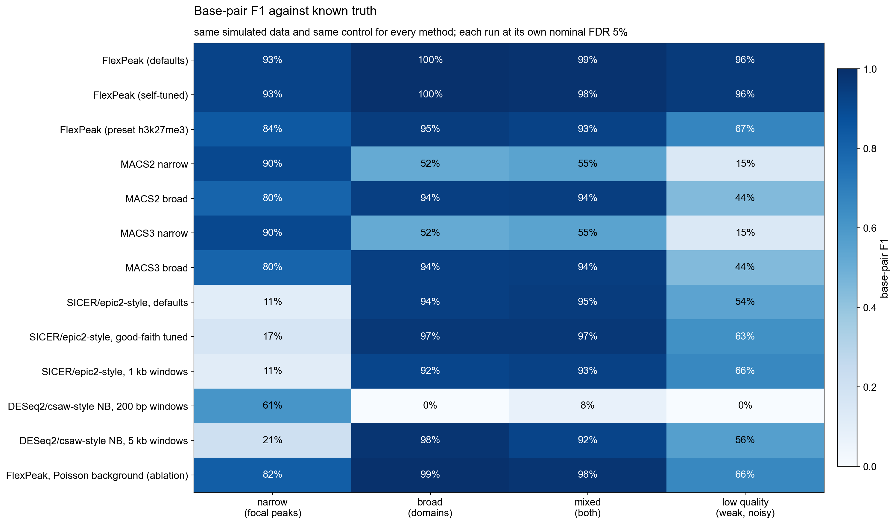

# FlexPeak

**Flexible, adaptive peak calling for ChIP-seq, CUT&RUN, CUT&Tag and ATAC-seq.**

FlexPeak calls narrow peaks and broad domains from the same run, nested — focal
sub-peaks are reported inside the domains that contain them — without being
told which kind of mark it is looking at. There is no pretrained model and no
training corpus: adaptivity comes from a per-sample tuning sweep that validates
each candidate setting on half of the sample's own reads.

```bash
pip install -e ".[bam,fast]"
flexpeak callpeak -t H3K9me3.bam -c input.bam -n H3K9me3
```

---

## Contents

- [Installation](#installation)
- [Quick start](#quick-start)
- [Commands](#commands)
- [Input](#input)
- [Output](#output)
- [How it works](#how-it-works)
- [Parameters](#parameters)
- [Python API](#python-api)
- [Benchmark](#benchmark)
- [Documentation](#documentation)
- [Citing](#citing)
- [License](#license)

---

## Installation

Python ≥ 3.9. The core depends on NumPy and SciPy only; everything else is an
extra.

```bash
git clone https://github.com/<org>/FlexPeak.git
cd FlexPeak
pip install -e ".[bam,bigwig,fast,figures]"
```

| Extra | Pulls in | Needed for |
|---|---|---|
| `bam` | pysam | BAM / CRAM input |
| `bigwig` | pyBigWig | bigWig input |
| `fast` | numba | compiled HMM kernels (a NumPy fallback is used otherwise; results agree) |
| `figures` | matplotlib | `--figures`, `flexpeak stats` |
| `dev` | pytest, ruff | the test suite |

Check the install:

```bash
flexpeak --version
python -m pytest tests -q
```

## Quick start

A treatment BAM with an input control, self-tuned:

```bash
flexpeak callpeak -t chip.bam -c input.bam -n sample --outdir out/
```

No control (CUT&Tag, most CUT&RUN) — fully supported, the background is
estimated from the treatment with signal excluded:

```bash
flexpeak callpeak -t cutntag.bam -n sample
```

A bigWig, a mark preset, no tuning sweep (bit-identical reruns):

```bash
flexpeak callpeak -t signal.bw --preset h3k27me3 --no-tune -n K27
```

A large BAM on a workstation, with an exclusion list and statistics figures:

```bash
flexpeak callpeak -t chip.bam -c input.bam --threads 8 \
    --blacklist mm10-blacklist.v2.bed.gz --figures -n sample
```

`out/sample_peaks.narrowPeak`, `out/sample_peaks.broadPeak`,
`out/sample_nested.bed` and `out/sample_peaks.nested.tsv` are written, plus a
QC summary. The tuning report (what was tried, what was chosen and why) is
printed to stderr and recorded in the output headers.

## Commands

| Command | Purpose |
|---|---|
| `flexpeak callpeak` | Call nested peaks. Self-tunes by default; `--no-tune` uses defaults or a `--preset`. |
| `flexpeak tune` | Run only the tuning sweep and print the objective curve, the selected plateau and the resolved parameters. |
| `flexpeak qc` | Library and enrichment QC for a sample, optionally against an existing call set. |
| `flexpeak stats` | Statistics figures (PDF) for an existing `.nested.tsv`: width and enrichment distributions, nesting, score QQ. |

`flexpeak <command> --help` lists every option.

## Input

- **BAM / CRAM**, coordinate-sorted and indexed. Paired-end reads become real
  fragments (one count per proper pair, template length ≤ 1 kb). Single-end
  reads are extended by a fragment length estimated from strand
  cross-correlation (also reported as NSC in QC). Duplicates, secondary,
  supplementary, QC-fail and unmapped reads are skipped; `--mapq` defaults to 30.
- **bigWig** signal. Treated as normalised signal rescaled to pseudo-counts, so
  p/q-values are approximate; the output header says so.
- Binned coverage is cached beside the input (`.flexpeak_cache/`, or
  `--cache-dir`) so reruns with different parameters skip parsing.

## Output

One nested call set, written as four projections:

| File | Format | Contents |
|---|---|---|
| `<name>_peaks.narrowPeak` | ENCODE narrowPeak | sub-peaks and isolated narrow peaks, with summits |
| `<name>_peaks.broadPeak` | ENCODE broadPeak | regions (domains and peaks) |
| `<name>_nested.bed` | BED12 | each region as one line with its sub-peaks as blocks — loads in IGV |
| `<name>_peaks.nested.tsv` | native TSV | the full parent/child structure, every statistic, and the complete resolved parameter set in the header; round-trips through `flexpeak stats` and `flexpeak qc` |

Every region carries fold enrichment, −log10 p and −log10 q from a negative
binomial test on the region's aggregate counts, with the dispersion of the sum
computed correctly (not the per-bin dispersion applied to the total). Regions
≥ 2 kb are labelled `domain`, the rest `peak`; the label is descriptive, not a
mode. Sub-peaks inside a domain carry their fold and significance **relative to
the domain's own level**, which is what "a focal peak inside a domain" means.

## How it works

Five stages, no learned components, every call with a p-value a reviewer can
reason about. Details and the measurements behind each default are in
[docs/DESIGN.md](docs/DESIGN.md).

1. **Coverage.** The BAM is scanned once per chromosome into fragment-anchor
   arrays; binning is a `bincount`. Chromosomes are independent and scanned in
   parallel on large files.
2. **Background.** A local background (maximum over window scales, as in MACS)
   estimated with apparent signal iteratively held out — so a broad domain does
   not define its own background — under a **negative binomial** with a
   genome-wide mean–dispersion trend. Poisson assumes mean = variance; real
   libraries are overdispersed, and that is why MACS's FDR degrades on noisy
   data. Swapping NB for Poisson in FlexPeak (`--poisson`) raises null false
   calls from 2 to 24.
3. **Segmentation.** A three-state NB hidden Markov model (background, weak,
   strong) over coarsened bins, with per-bin background means so mappability
   and control structure stay inside the model. Boundaries are inferred from
   the posterior, not set by a gap parameter — which is the specific SICER
   failure FlexPeak avoids. The segmentation scale and the minimum dwell time
   are read off the sample's own autocorrelation length.
4. **Sub-peaks.** Scale-space detection inside every region: maxima that persist
   across smoothing bandwidths are structure, single-scale maxima are noise.
   Inside domains they are tested against the domain level and gated by a
   robust outlier test against the sample's own distribution of candidate
   maxima, so a noisy flat domain reports none.
5. **Self-tuning.** The reads on a stratified chromosome subset are split into
   two halves. A 27-point grid (posterior cutoff × fold floor × segmentation
   scale) is called on each half and scored by how well its calls' fitted
   enrichment predicts the *other* half's reads — a held-out likelihood that
   penalises missed signal, called noise and over-merging alike — plus agreement
   between halves and a territory penalty. The plateau of the curve is chosen,
   not the argmax. The whole sweep is a few seconds because the background and
   the HMM are fitted once per half and re-thresholded.

## Parameters

Defaults are intended to be left alone; the tuner adjusts the three that matter
most. Every default in `CallParams` is documented with the measurement that set
it.

| Option | Default | Notes |
|---|---|---|
| `-q / --qvalue` | 0.05 | FDR over regions and, separately, over sub-peaks. Region FDR is taken over the whole genome's worth of candidate-sized tiles, not just the candidates returned. |
| `--min-fold` | 1.2 | Region fold floor. Was 1.5, which erased every 1.6× domain; significance, not this floor, keeps noise out. |
| `--min-width` | 100 bp | Narrowest region reported. |
| `--bin-size` | 25 bp (preset-dependent) | Reporting resolution. The HMM segments at a coarser, data-derived scale. |
| `--segment-bin-size` | automatic | Autocorrelation length / 8, floored at 100 bp. Set explicitly to override. |
| `--preset` | — | `tf`, `h3k4me3`, `h3k27ac`, `h3k27me3`, `h3k9me3`, `h3k36me3`, `atac`. Deterministic fallbacks, not calibrated — prefer the tuner. |
| `--no-tune` | off | Skip the sweep. Required for bit-identical reruns. |
| `--tune-chroms` | 3 | Chromosomes in the tuning subset (largest, median, smallest). |
| `--threads` | automatic | Worker processes for the BAM scan. |
| `--blacklist` | — | BED(.gz) of regions to drop calls in. |
| `--poisson`, `--background-exclude-fold 0`, `--no-dwell-floor` | — | Ablation switches; each removes one documented component. |

## Python API

```python
from flexpeak import load_signal, call_peaks, tune, CallParams

treat = load_signal("chip.bam", bin_size=25)        # cached npz on reuse
ctrl  = load_signal("input.bam", bin_size=25)

result = tune(treat, ctrl, base=CallParams())        # TuneResult: params, curve, report()
print(result.report())

peaks = call_peaks(treat, ctrl, result.params)       # NestedPeakSet
peaks.write_all("out/sample")                        # the four files above

for region in peaks:
    print(region.chrom, region.start, region.end, region.kind,
          region.fold_enrichment, region.neg_log10_q, len(region.subpeaks))
```

`Coverage` (binned signal; `rebin`, `subset`, `thin`, `split`), `BackgroundModel`,
`NestedPeakSet` / `Region` / `SubPeak` and `TuningObjective` are all public.
`flexpeak.simulate.simulate()` generates narrow / broad / mixed data with exact
truth and is what the tests and the benchmark are built on.

## Benchmark

`Benchmark/` is a reproducible comparison on simulated data with exact ground
truth: five datasets (narrow, broad, mixed, low-quality, null), MACS2 and MACS3
run as subprocesses, re-implementations of the SICER/epic2 island algorithm and
of windowed NB (csaw/DESeq2-style) testing, and a Poisson ablation of FlexPeak
itself. It is a regression harness and a sanity check, not evidence about
experimental data — the background is drawn from the model family FlexPeak
assumes, which favours it on the null set by construction, and the
re-implemented baselines are not the published tools.

```bash
python Benchmark/run_benchmark.py     # ~7 min; writes Benchmark/results/metrics.tsv
python Benchmark/make_figures.py      # Benchmark/figures/B1..B6
```

| | FlexPeak | MACS2 narrow | MACS2 broad | SICER-style, tuned |
|---|---:|---:|---:|---:|
| narrow peaks (TF / H3K4me3-like) | **93%** | 90% | 80% | 17% |
| broad domains (H3K27me3-like) | **99%** | 52% | 94% | 97% |
| mixed: domains with focal peaks inside (H3K9me3-like) | **99%** | 55% | 94% | 97% |
| low-quality: 1.6× domains, overdispersed | **96%** | 15% | 44% | 63% |
| false calls on a null genome | **2** | 18 | 121 | 286 |
| wall clock, 4.5 Mb genome incl. BAM parse | **2.9 s** | 7.5 s | 7.5 s | — |

Base-pair F1 against exact truth on simulated data, every method at its own
nominal FDR 5%, same BAMs and same control. Full protocol, caveats and the
two re-implemented baselines: [Benchmark/README.md](Benchmark/README.md).
**These are simulation results; experimental-data validation is in progress.**



What the figures show: FlexPeak is the only row that is dark across all four
columns (B1); on broad domains its boundaries are an order of magnitude tighter
than MACS broad (median |Δstart| 338 bp vs 18.9 kb) with zero fragmentation
(B3); on low-quality data it sits alone in the upper-right of the
precision–recall panel (B2); and end to end it is 2.6× faster than MACS2 (B6).
Where it loses: MACS narrow is marginally more precise on focal peaks (95% vs
94%), and the self-tuner reproduces the defaults rather than improving on them
— see [Benchmark/README.md §5](Benchmark/README.md) for the honest accounting.

## Documentation

- [docs/TUTORIAL.md](docs/TUTORIAL.md) — a small reproducible run: first call,
  reading the outputs and QC, inspecting a locus.
- [docs/DESIGN.md](docs/DESIGN.md) — the algorithm, the reasoning, and the
  measurements behind every default, including the ones that were wrong.
- [Benchmark/README.md](Benchmark/README.md) — the method comparison, protocol
  and threats to validity.
- [testing/README.md](testing/README.md) — integration test on public GEO
  H3K9me3 data.
- [examples/figures.py](examples/figures.py) — correctness figures on simulated
  data with known truth.

## Citing

FlexPeak is unpublished. If you use it, please cite this repository and the
version (`flexpeak --version`); every output header records the exact
parameter set that produced it.

## License

MIT.
