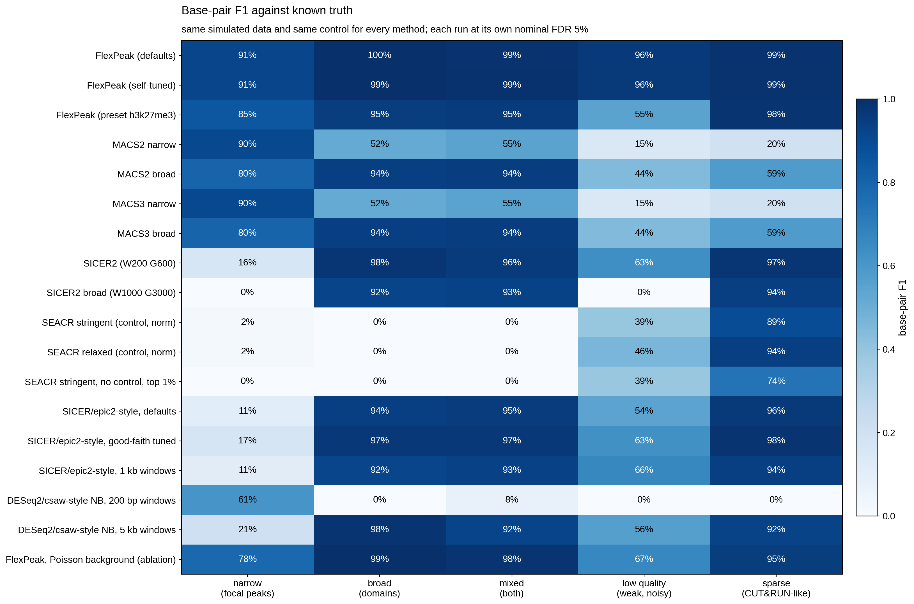

# FlexPeak

**Flexible, adaptive peak calling for ChIP-seq, CUT&RUN, CUT&Tag and ATAC-seq.**

FlexPeak calls narrow peaks and broad domains from the same run, nested — focal
sub-peaks are reported inside the domains that contain them — without being
told which kind of mark it is looking at. There is no pretrained model and no
training corpus: adaptivity comes from a per-sample tuning sweep that validates
each candidate setting on half of the sample's own reads.

```bash
pip install -e ".[bam,fast]"
flexpeak callpeak -t H3K9me3.bam -c input.bam -n H3K9me3
```

---

## Contents

- [Installation](#installation)
- [Quick start](#quick-start)
- [Commands](#commands)
- [Input](#input)
- [Output](#output)
- [How it works](#how-it-works)
- [Parameters](#parameters)
- [Python API](#python-api)
- [Benchmark](#benchmark)
- [Documentation](#documentation)
- [Citing](#citing)
- [License](#license)

---

## Installation

Python ≥ 3.9. The core depends on NumPy and SciPy only; everything else is an
extra.

```bash
git clone https://github.com/<org>/FlexPeak.git
cd FlexPeak
pip install -e ".[bam,bigwig,fast,figures]"
```

| Extra | Pulls in | Needed for |
|---|---|---|
| `bam` | pysam | BAM / CRAM input |
| `bigwig` | pyBigWig | bigWig input |
| `fast` | numba | compiled HMM kernels (a NumPy fallback is used otherwise; results agree) |
| `figures` | matplotlib | `--figures`, `flexpeak stats` |
| `dev` | pytest, ruff | the test suite |

Check the install:

```bash
flexpeak --version
python -m pytest tests -q
```

## Quick start

A treatment BAM with an input control, self-tuned:

```bash
flexpeak callpeak -t chip.bam -c input.bam -n sample --outdir out/
```

No control (CUT&Tag, most CUT&RUN) — fully supported, the background is
estimated from the treatment with signal excluded:

```bash
flexpeak callpeak -t cutntag.bam -n sample
```

A bigWig, a mark preset, no tuning sweep (bit-identical reruns):

```bash
flexpeak callpeak -t signal.bw --preset h3k27me3 --no-tune -n K27
```

A large BAM on a workstation, with an exclusion list and statistics figures:

```bash
flexpeak callpeak -t chip.bam -c input.bam --threads 8 \
    --blacklist mm10-blacklist.v2.bed.gz --figures -n sample
```

`out/sample_peaks.narrowPeak`, `out/sample_peaks.broadPeak`,
`out/sample_nested.bed` and `out/sample_peaks.nested.tsv` are written, plus a
QC summary. The tuning report (what was tried, what was chosen and why) is
printed to stderr and recorded in the output headers.

## Commands

| Command | Purpose |
|---|---|
| `flexpeak callpeak` | Call nested peaks. Self-tunes by default; `--no-tune` uses defaults or a `--preset`; `--quick` lets the scan below choose the scale and shrink the sweep. |
| `flexpeak scan` | Quick quantification of one chromosome (chr1) at 10, 25 and 50 bp: count distributions, a sigma-clipped background, the signal excess beyond 5 SD, run and gap lengths, and the settings they imply. Seconds, before any full load. |
| `flexpeak diff` | Differential regions between two conditions (replicates supported), THOR-style: a three-state HMM over the two-condition split with beta-binomial emissions, overdispersion read from the replicates. |
| `flexpeak tune` | Run only the tuning sweep and print the objective curve, the selected plateau and the resolved parameters. |
| `flexpeak qc` | Library and enrichment QC for a sample, optionally against an existing call set. |
| `flexpeak stats` | Statistics figures (PDF) for an existing `.nested.tsv`: width and enrichment distributions, nesting, score QQ. |

`flexpeak <command> --help` lists every option.

## Input

- **BAM / CRAM**, coordinate-sorted and indexed. Paired-end reads become real
  fragments (one count per proper pair, template length ≤ 1 kb). Single-end
  reads are extended by a fragment length estimated from strand
  cross-correlation (also reported as NSC in QC). Duplicates, secondary,
  supplementary, QC-fail and unmapped reads are skipped; `--mapq` defaults to 30.
- **bigWig** signal. Treated as normalised signal rescaled to pseudo-counts, so
  p/q-values are approximate; the output header says so.
- Binned coverage is cached beside the input (`.flexpeak_cache/`, or
  `--cache-dir`) so reruns with different parameters skip parsing.

## Output

One nested call set, written as four projections:

| File | Format | Contents |
|---|---|---|
| `<name>_peaks.narrowPeak` | ENCODE narrowPeak | sub-peaks and isolated narrow peaks, with summits |
| `<name>_peaks.broadPeak` | ENCODE broadPeak | regions (domains and peaks) |
| `<name>_nested.bed` | BED12 | each region as one line with its sub-peaks as blocks — loads in IGV |
| `<name>_peaks.nested.tsv` | native TSV | the full parent/child structure, every statistic, and the complete resolved parameter set in the header; round-trips through `flexpeak stats` and `flexpeak qc` |

Every region carries fold enrichment, −log10 p and −log10 q from a negative
binomial test on the region's aggregate counts, with the dispersion of the sum
computed correctly (not the per-bin dispersion applied to the total). Regions
≥ 2 kb are labelled `domain`, the rest `peak`; the label is descriptive, not a
mode. Sub-peaks inside a domain carry their fold and significance **relative to
the domain's own level**, which is what "a focal peak inside a domain" means.

## How it works

Five stages, no learned components, every call with a p-value a reviewer can
reason about. Details and the measurements behind each default are in
[docs/DESIGN.md](docs/DESIGN.md).

1. **Coverage.** The BAM is scanned once per chromosome into fragment-anchor
   arrays; binning is a `bincount`. Chromosomes are independent and scanned in
   parallel on large files.
2. **Background.** A local background (maximum over window scales, as in MACS)
   estimated with apparent signal iteratively held out — so a broad domain does
   not define its own background — under a **negative binomial** with a
   genome-wide mean–dispersion trend. Poisson assumes mean = variance; real
   libraries are overdispersed, and that is why MACS's FDR degrades on noisy
   data. Swapping NB for Poisson in FlexPeak (`--poisson`) raises null false
   calls from 2 to 24.
3. **Segmentation.** A three-state NB hidden Markov model (background, weak,
   strong) over coarsened bins, with per-bin background means so mappability
   and control structure stay inside the model. Boundaries are inferred from
   the posterior, not set by a gap parameter — which is the specific SICER
   failure FlexPeak avoids. The segmentation scale and the minimum dwell time
   are read off the sample's own autocorrelation length.
4. **Sub-peaks.** For domain and mixed marks, a second, focal pass with
   MACS's local lambda: the plain 10 kb local mean (1/5/10 kb from a
   control) maxed with the wide background, a sliding sum over the focal
   feature scale, a negative-binomial tail test with the dispersion
   measured on those sums, BH over the genome. Its regions become the
   sub-peaks of the domains they fall in (tested against the local level,
   which is what "a peak inside a domain" means) and standalone peaks
   elsewhere, so a promoter cluster is one domain with one narrow sub-peak
   per promoter. A domain that holds sub-peaks is re-tested on its residual
   (the sub-peak bins taken out); if the level between the peaks is not
   itself enriched, the domain dissolves into standalone peaks. For narrow
   marks, scale-space detection inside every
   region: maxima that persist across smoothing bandwidths are structure,
   single-scale maxima are noise.
5. **Self-tuning.** The reads on a stratified chromosome subset are split into
   two halves. A 27-point grid (posterior cutoff × fold floor × segmentation
   scale) is called on each half and scored by how well its calls' fitted
   enrichment predicts the *other* half's reads — a held-out likelihood that
   penalises missed signal, called noise and over-merging alike — plus agreement
   between halves and a territory penalty. The plateau of the curve is chosen,
   not the argmax. The whole sweep is a few seconds because the background and
   the HMM are fitted once per half and re-thresholded.

### The quick scan and `--quick`

```bash
flexpeak scan -t chip.bam                       # chr1 at 10/25/50 bp, text report
flexpeak scan -t chip.bam --json -o scan.json   # machine-readable
flexpeak callpeak -t chip.bam -c input.bam -n sample --quick
```

The scan reads six 10 Mb windows, one from each of six chromosomes spread over
the size ranking (60 Mb in total, read directly from the BAM/bigWig, so it
costs what one chr1 window did), and coarsens them to each candidate bin size.
Each window is also classified on its own and the pooled class is kept on the
safe side of their vote: a punctate mark called mixed only loses resolution,
a domain mark called narrow loses its domains (`--scan-chrom chr1` restores
the single-chromosome scan). At each size it separates background from
candidate signal by **iterative sigma clipping** (median/MAD start, clip above
mean + 5 SD, re-estimate, repeat), compares the observed tail with the tail a
negative binomial with the clipped moments would produce, and reports the
**excess** as the signal fraction. The same rule on the signal smoothed at
1 kb and 5 kb, after a local baseline is removed, shows how much of the
chromosome sits in domains and how wide they are. A sample is *narrow* when
it has bin-level excess with a real signal-to-noise ratio, *broad* when it
has smoothed excess that focal peaks cannot account for, *mixed* when both,
*null* when neither; the class sets the bin size (about 20 bins per feature),
background windows, segmentation scale, width floors and a data-driven
`max_gap` -- regions closer than that are **connected only when the gap
carries similar enrichment**, so pieces of one feature rejoin without fusing
two features across background. Every rule and number is printed in the
report. On the GSE285245 CUT&RUN marks: CTCF narrow, H3K4me3/H3K27ac/H3K27me3
mixed, H3K9me3 broad.

`callpeak --quick` runs the scan, applies its recommendation, then tunes on
four stratified 25 Mb windows (100 Mb, four chromosomes) instead of the
27-point grid on three whole chromosomes. The axes are the ones that set
what a call looks like -- fold floor, confidence, gap merging, the focal
background floor and (domain marks) the weak-domain pass -- swept one at a
time, 5-10 evaluations. With `--replicates rep1 rep2 ...` the tuning halves
are replicate groups (1,3 | 2,4) rather than read splits, and the share of
calls supported by >= 3/4 replicates enters the objective: the held-out
likelihood alone saturates on domain marks. Measured on the GSE285245 Cl13
marks (six chromosomes; replicate support scored on chromosomes the tuning
did not see), H3K27me3 call support 0.93 -> 0.99 with recall 0.65 -> 0.75,
H3K9me3 0.93 -> 0.99 (recall 0.38 -> 0.35), H3K4me3 0.95 -> 0.99, H3K27ac and
CTCF unchanged; H3K9me3 on one node 250 s -> 160 s. For domain-scale
backgrounds (>= 500 kb windows) the background exclusion is anchored on a
running median and the dispersion is fitted on background bins only, so
widespread moderate enrichment no longer becomes part of the background. Explicit `--preset`, `--bin-size`, `--min-fold`,
`--min-width` and `--segment-bin-size` still win. On the pooled GSE285245 H3K9me3 bigWig
(chr1-19+X, cold cache, final code) it ran in 128 s against 425 s for the
full 27-point sweep -- which needed `--preset h3k9me3` to get its scale
right -- and 88 s with no tuning at all, and the three agree (Jaccard 0.77
to 0.92; FRiP 0.34-0.36 on 13-16% of the genome in 3,900-4,900 regions,
with 50-200 sub-peaks). The sweep itself was never the main cost; what
`--quick` removes is the preset. Note the H3K9me3 view this gives is the
heterochromatin landscape (1 Mb / 5 Mb background windows); the earlier,
local view (62 Mb of territory in 3,880 regions) is `--windows
200000,1000000`.

### Differential calling

```bash
flexpeak diff -a KO_rep1.bam KO_rep2.bam -b WT_rep1.bam WT_rep2.bam -n KO_vs_WT
flexpeak diff -a Arm.bw -b Cl13.bw --chroms chr1,chr2 -n Arm_vs_Cl13      # single samples
```

Outputs `<name>_diffpeaks.narrowPeak` (strand `+` = higher in A, `-` = higher
in B; signalValue = log2 fold change), `<name>_diffpeaks.tsv` (per-replicate
counts, posterior, p and q), and `<name>_gain.bed` / `<name>_loss.bed`.

How it works: each sample is normalised (default: matched sigma-clipped
background level; `--norm tmm` or `total`), replicates are averaged per
condition, and each bin's split `a / (a + b)` is modelled by a three-state HMM
(same / higher in A / higher in B) with beta-binomial emissions. The
per-bin beta-binomial overdispersion is estimated from replicate-to-replicate
scatter when replicates exist and inside the EM otherwise (floored at an
edgeR-style BCV 0.2 prior, because without replicates the EM estimate
collapses). The HMM dwell floor comes from the autocorrelation length of the
log ratio, so broad differential domains are not shredded; runs of the
gain/loss posterior become candidate regions, and nearby same-direction runs
are connected through gaps that lean the same way. Each candidate is then
tested two-sided on its aggregate split with a **region-scale**
overdispersion (replicate scatter of the regions' sums, shrunk toward the
prior; the prior alone without replicates), because between-sample
variation is correlated across the bins of a region and a per-bin rho would
call any long run at a modest fold. BH runs over the candidates, as
count-based differential testing does over the regions it counts; the HMM is
the genome-wide screen. bigWig input is put back on a fragment scale from its
own background noise and flagged as approximate, and when the two conditions
together average fewer than 10 fragments per bin the bins are coarsened
until they do (a 0.4-fragment split is noise, measured as millions of
candidate runs on sparse CUT&RUN). A candidate must also be enriched over the input, or
without one over FlexPeak's no-control local background of the pooled
signal (100 kb / 500 kb windows, wider for a broad mark), in at least one
condition: without that gate the chain tracks regional background
differences between the two conditions. `--within-peaks` restricts calls
further, to FlexPeak peaks called on either pooled condition.

## Parameters

Defaults are intended to be left alone; the tuner adjusts the three that matter
most. Every default in `CallParams` is documented with the measurement that set
it.

| Option | Default | Notes |
|---|---|---|
| `-q / --qvalue` | 0.05 | FDR over regions and, separately, over sub-peaks. Region FDR is taken over the whole genome's worth of candidate-sized tiles, not just the candidates returned. |
| `--min-fold` | 1.2 | Region fold floor. Was 1.5, which erased every 1.6× domain; significance, not this floor, keeps noise out. |
| `--min-width` | 100 bp | Narrowest region reported. |
| `--bin-size` | 25 bp (preset-dependent) | Reporting resolution. The HMM segments at a coarser, data-derived scale. |
| `--segment-bin-size` | automatic | Autocorrelation length / 8, floored at 100 bp. Set explicitly to override. |
| `--preset` | — | `tf`, `h3k4me3`, `h3k27ac`, `h3k27me3`, `h3k9me3`, `h3k36me3`, `atac`. Deterministic fallbacks, not calibrated — prefer the tuner. |
| `--no-tune` | off | Skip the sweep. Required for bit-identical reruns. |
| `--tune-chroms` | 3 | Chromosomes in the tuning subset (largest, median, smallest). |
| `--threads` | automatic | Worker processes for the BAM scan. |
| `--blacklist` | — | BED(.gz) of regions to drop calls in. |
| `--poisson`, `--background-exclude-fold 0`, `--no-dwell-floor` | — | Ablation switches; each removes one documented component. |

## Python API

```python
from flexpeak import load_signal, call_peaks, tune, CallParams

treat = load_signal("chip.bam", bin_size=25)        # cached npz on reuse
ctrl  = load_signal("input.bam", bin_size=25)

result = tune(treat, ctrl, base=CallParams())        # TuneResult: params, curve, report()
print(result.report())

peaks = call_peaks(treat, ctrl, result.params)       # NestedPeakSet
peaks.write_all("out/sample")                        # the four files above

for region in peaks:
    print(region.chrom, region.start, region.end, region.kind,
          region.fold_enrichment, region.neg_log10_q, len(region.subpeaks))
```

`Coverage` (binned signal; `rebin`, `subset`, `thin`, `split`), `BackgroundModel`,
`NestedPeakSet` / `Region` / `SubPeak` and `TuningObjective` are all public.
`flexpeak.simulate.simulate()` generates narrow / broad / mixed data with exact
truth and is what the tests and the benchmark are built on.

## Benchmark

`Benchmark/` is a reproducible comparison on simulated data with exact ground
truth: five datasets (narrow, broad, mixed, low-quality, null), MACS2 and MACS3
run as subprocesses, re-implementations of the SICER/epic2 island algorithm and
of windowed NB (csaw/DESeq2-style) testing, and a Poisson ablation of FlexPeak
itself. It is a regression harness and a sanity check, not evidence about
experimental data — the background is drawn from the model family FlexPeak
assumes, which favours it on the null set by construction, and the
re-implemented baselines are not the published tools.

```bash
python Benchmark/run_benchmark.py     # ~7 min; writes Benchmark/results/metrics.tsv
python Benchmark/make_figures.py      # Benchmark/figures/B1..B6
```

| | FlexPeak | MACS2 narrow | MACS2 broad | SICER2 | SEACR (relaxed) |
|---|---:|---:|---:|---:|---:|
| narrow peaks (TF / H3K4me3-like) | **91%** | 90% | 80% | 16% | 2% |
| broad domains (H3K27me3-like) | **100%** | 52% | 94% | 98% | 0% |
| mixed: domains with focal peaks inside (H3K9me3-like) | **99%** | 55% | 94% | 96% | 0% |
| low-quality: 1.6x domains, overdispersed | **96%** | 15% | 44% | 63% | 46% |
| sparse, CUT&RUN-like (SEACR's home ground) | **99%** | 20% | 59% | 97% | 94% |
| false calls on a null genome | **2** | 18 | 121 | 430 | 1 |
| wall clock, 4.5 Mb genome incl. BAM parse | **3.0 s** | 5.2 s | 5.3 s | 26 s | 3 s |

Base-pair F1 against exact truth on simulated data, every method at its own
nominal FDR 5%, same BAMs and same control; MACS2 2.2.9.1, MACS3 3.0.4,
SICER2 1.0.3 and SEACR 1.3 are the real tools run as subprocesses (MACS3
matches MACS2 on every dataset). Full protocol, caveats, the differential
comparison against THOR, and the two re-implemented baselines:
[Benchmark/README.md](Benchmark/README.md).
**These are simulation results; experimental-data runs are in `testing/`.**



What the figures show: FlexPeak is the only row that is dark across all five
columns (B1); on broad domains its boundaries are tighter than MACS broad
(median |Δstart| 338 bp vs 18.9 kb) and SICER2 (1.4 kb) with zero
fragmentation (B3); SICER2 calls 14-18% of a null genome (B4); on low-quality
data FlexPeak sits alone in the upper right of the precision-recall panel
(B2). Where it loses: MACS narrow is marginally more precise on focal peaks
(95% vs 94%), SICER2 recovers slightly more broad territory, and the
self-tuner reproduces the defaults rather than improving on them -- see
[Benchmark/README.md §5](Benchmark/README.md) for the honest accounting.

## Documentation

- [docs/TUTORIAL.md](docs/TUTORIAL.md) — a small reproducible run: first call,
  reading the outputs and QC, inspecting a locus.
- [docs/DESIGN.md](docs/DESIGN.md) — the algorithm, the reasoning, and the
  measurements behind every default, including the ones that were wrong.
- [Benchmark/README.md](Benchmark/README.md) — the method comparison, protocol
  and threats to validity.
- [testing/README.md](testing/README.md) — integration test on public GEO
  H3K9me3 data.
- [examples/figures.py](examples/figures.py) — correctness figures on simulated
  data with known truth.
- [examples/locus_tracks.py](examples/locus_tracks.py) — locus views: a bigWig
  with the called regions and sub-peaks drawn under it, one panel per track
  (`docs/figures/tracks/` shows Pdcd1, Tcf7, Havcr2 and Tox for the five
  GSE285245 marks, the H3K9me3 full/quick/no-tune comparison and the
  Arm-vs-Cl13 differential). `cluster/40_tracks.sbatch` also writes an IGV
  session (`testing/results/tracks/igv_session_mm10.xml`) with the signal
  and peak files.

## Citing

FlexPeak is unpublished. If you use it, please cite this repository and the
version (`flexpeak --version`); every output header records the exact
parameter set that produced it.

## License

MIT.
