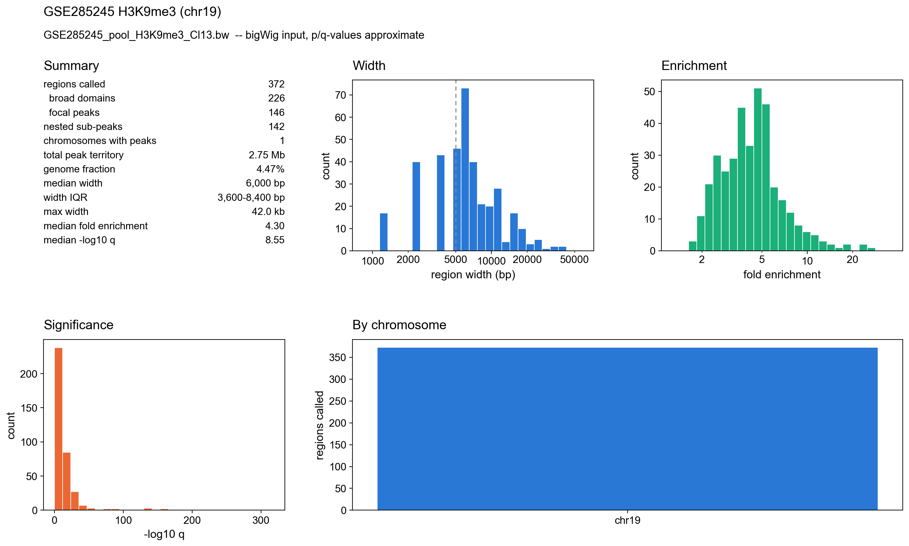

# Tutorial: A Tiny Reproducible FlexPeak Run

This tutorial uses synthetic data generated from a fixed seed, so it is small,
fast, and self-contained. An example on public data,
[`examples/geo_h3k9me3.py`](https://github.com/helenhuangmath/FlexPeak/blob/main/examples/geo_h3k9me3.py), downloads its GEO input
on demand (see the last section).

## Install

```bash
cd /path/to/FlexPeak
pip install -e ".[figures,fast]"
```

Use `python -m flexpeak.cli` anywhere below if `flexpeak` is not on your `PATH`.

## Run

```bash
python examples/tutorial_simple.py
```

The script creates one mixed synthetic sample with known truth, calls peaks, and
writes outputs under `examples/tutorial_out/`:

```text
examples/tutorial_out/
  tutorial_mixed_peaks.narrowPeak
  tutorial_mixed_peaks.broadPeak
  tutorial_mixed_nested.bed
  tutorial_mixed_peaks.nested.tsv
  tutorial_mixed_qc.txt
```

`tutorial_mixed_peaks.nested.tsv` is the native format. It preserves the
parent/child relationship between broad regions and nested sub-peaks, so it is
the file to use when re-running QC or figures later.

## Inspect QC

```bash
cat examples/tutorial_out/tutorial_mixed_qc.txt
```

Read these rows first:

- `regions`, `domains`, and `subpeaks`: the shape of the call set.
- `genome fraction`: how much territory was called.
- `FRiP`: fraction of signal inside called regions.
- `width bimodality`: whether widths look like one population or a mixed
  narrow/broad sample.

## Redraw Figures

```bash
flexpeak stats \
  -p examples/tutorial_out/tutorial_mixed_peaks.nested.tsv \
  --outdir examples/tutorial_out/figures
```


## Figures From Real Data

[`examples/geo_h3k9me3.py`](https://github.com/helenhuangmath/FlexPeak/blob/main/examples/geo_h3k9me3.py)
calls peaks on a public H3K9me3 bigWig (GEO GSE285245, mm10, chr19). The
bigWig, the coverage cache and the results are written to `examples/geo_out/`,
which is not version-controlled. Regenerate the figure below with:

```bash
python examples/geo_h3k9me3.py --quick --keep-figures
```

The one-page summary shows counts, region widths, fold enrichment, significance
and calls per chromosome. H3K9me3 gives mostly broad domains of a few kb.
Because the input is a bigWig rather than raw counts, the q-values are
approximate.


